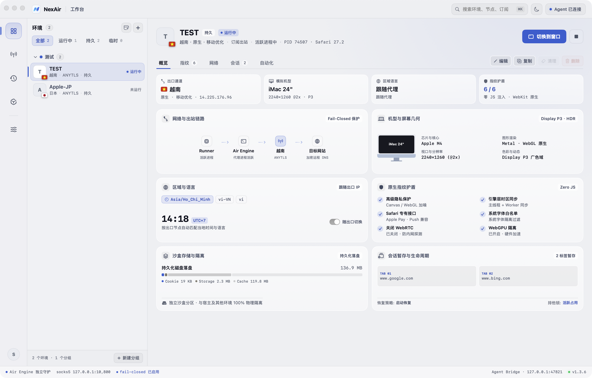
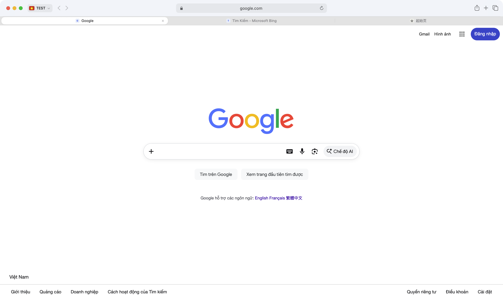
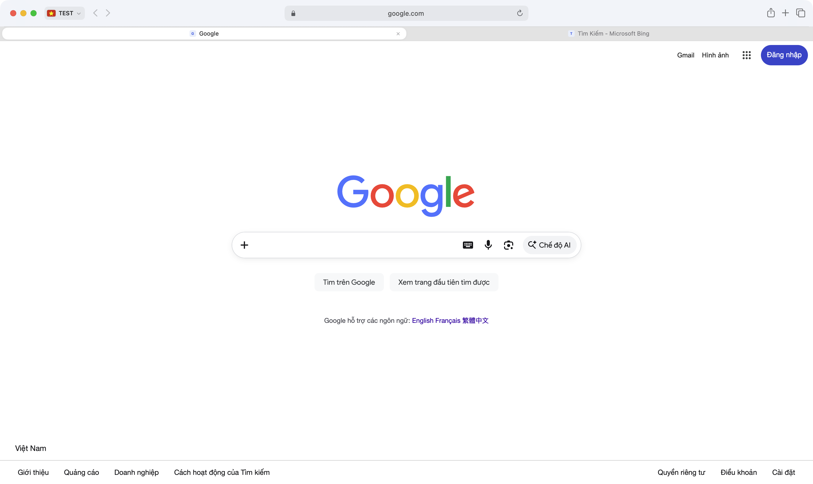

<div align="center">
  
  <h1 style="margin-top: 16px; font-size: 34px; font-weight: 800; letter-spacing: -0.02em;">NETAIR</h1>
  <p style="font-size: 16px; font-weight: 500; color: #6e6e73;">
    <strong>The Native macOS Multi-Environment Fingerprint Browser & AI Agent Platform</strong>
  </p>
  <p style="max-width: 720px; font-size: 13.5px; line-height: 1.6; color: #86868b;">
    Engineered exclusively for macOS 14+ Sonoma & macOS 15+ Sequoia · Built on Genuine Apple WebKit · Absolute Zero JavaScript Injection · Fail-Closed Network Isolation · Designed for E-Commerce, Operations & AI Automation
  </p>
  <p>
    <a href="https://github.com/XideaDev/NETAir.APP/releases/latest"></a>
    
    
    
    
    
  </p>
  <p>
    <strong>English</strong> · <a href="README.zh-CN.md">简体中文</a> · <a href="#-why-netair">Why NETAIR</a> · <a href="#-use-cases">Use Cases</a> · <a href="#-features--capabilities">Features</a> · <a href="#-ai-agent--mcp-ecosystem">AI Agent</a> · <a href="#-download--installation">Download</a>
  </p>
</div>

---

## ⚡ Why NETAIR?

Most multi-account browsers on the market are built upon modified Chromium or Electron distributions. To emulate different devices, they execute JavaScript before page loads to alter `window`, `navigator`, and hardware properties.

Modern enterprise anti-fraud systems (**Cloudflare Turnstile, DataDome, Akamai, Kasada**) easily detect these modifications through prototype chain validation, function introspection, and cross-frame property leaks.

```
Traditional Solutions (Chromium) ──► Modifies JS Prototypes ──► Flagged by Cloudflare / DataDome
NETAIR Native WebKit             ──► Native Engine & OS Settings ──► Genuine Safari from Apple Pool
```

### NETAIR vs. Traditional Anti-Detect Browsers

| Dimension | Traditional Modified Browsers | NETAIR Native Solution |
|---|---|---|
| **Underlying Engine** | Modified Chromium / Electron | Genuine Apple WebKit (Native Safari Engine) |
| **Fingerprint Mechanism** | JavaScript prototype alteration | System-level environment and native engine settings |
| **Risk Engine Detection** | Easily flagged by prototype anomalies | Indistinguishable from real Mac Safari devices |
| **Network Protection** | Soft proxies; risk of falling back to direct IP | Strict Fail-Closed; immediate traffic block on drop |
| **Credential Security** | Plaintext files or third-party cloud sync | Local sandboxed encrypted vault & macOS Keychain |
| **System Resource Usage** | High CPU and memory overhead | Lightweight native AppKit/SwiftUI design |
| **AI Automation** | Complex external extensions and drivers | Native Model Context Protocol (MCP) and CLI integration |

### Three Core Commitments

1. 🛡️ **Absolute Zero JS Injection**:
   NETAIR never injects tampering scripts into webpage browsing contexts. Target websites interact with genuine, untainted WebKit JavaScript environments, matching normal Mac Safari devices.
2. 🔒 **Fail-Closed Network Protection**:
   Each profile connects through a dedicated proxy route. If the proxy fails or disconnects, network traffic halts immediately. The browser never falls back to local direct connections, safeguarding your true IP and preventing DNS leaks.
3. 🔐 **Local Sandboxed Encryption Vault**:
   Proxy credentials and profile metadata are stored locally in an encrypted sandboxed vault and macOS Keychain. Data is never uploaded to central servers, keeping your accounts secure.

---

## 🎯 Use Cases

- **Cross-Border E-Commerce Multi-Store Management**: Run independent accounts on Amazon, eBay, Shopee, TikTok Shop, AliExpress, and Walmart with isolated session states to prevent account linkage.
- **Social Media Marketing & Matrix Growth**: Manage separate profiles on X (Twitter), Facebook, Instagram, LinkedIn, YouTube, and Discord without cross-contamination.
- **Advertising Verification & Affiliate Marketing**: Verify Google Ads and Meta Ads campaigns, landing pages, and geo-targeted promotions accurately from global locations.
- **Account Warmup & Digital Asset Protection**: Keep cookies, local storage, sessions, and device attributes isolated to nurture high-value business accounts safely.
- **AI Agent Automation & Web Tasks**: Enable autonomous AI agents to perform data collection, automated form completion, and workflow execution within isolated browser environments.

---

## ✨ Features & Capabilities

### 1. 34 Authentic Mac Device Profiles
Simulate real Apple Silicon and Intel Mac devices with authentic viewport geometries, Retina scaling ratios, Display P3 wide color gamut, and HDR characteristics:
- **MacBook Pro 16" & 14"** (Apple Silicon M-Series, Liquid Retina XDR, Display P3, notch geometry)
- **MacBook Air 15" & 13"** (Display P3, thin-and-light form factor)
- **iMac 24" 4.5K Retina** (4480×2520 @2x ultra-clear desktop display)
- **Mac Studio with 5K Studio Display** (5120×2880 @2x)
- **Mac Pro with 6K Pro Display XDR** (6016×3384 @2x, P3 HDR)

### 2. Automatic Region & Locale Following
Select an outbound node anywhere across the globe. NETAIR detects the exit IP location and automatically synchronizes:
- **Language Headers** (`Accept-Language` and language preferences)
- **System Time Zone** (matches exit location accurately)
- **Locale Formats** (currency, numbers, and calendars)

### 3. Native Font Fingerprint Isolation
Blocks font enumeration techniques without altering web page scripts. NETAIR preserves the baseline macOS system font stack (including comprehensive CJK fonts) while filtering language packs to match target locales.

### 4. Built-in Multi-Protocol Proxy Engine
No need to launch third-party proxy clients. NETAIR supports universal subscription links as well as individual or batch node imports:
- `VLESS` (Reality / uTLS / Vision / gRPC / WebSocket)
- `VMess` (WebSocket / gRPC / TLS)
- `Trojan`
- `Shadowsocks` & `SS2022`
- `AnyTLS`, `SOCKS5`, `HTTP`

### 5. Sandboxed Data Isolation & Session Restore
Every profile operates with independent cookies, cache, LocalStorage, IndexedDB, and browsing records. When reopening a profile, previous tabs and session states can be automatically restored.

### 6. Authentic Safari Experience & High-Performance Tab Bar
- **Pixel-Perfect Safari Capsule Tabs**: 30pt height, continuous squircle corners, and smooth layout distribution.
- **Vector Flag Capsule**: Displays crisp vector flags matching the active proxy location with outbound detail inspection.
- **High-Concurrency Tab Engine**: Event-driven UI updates ensure smooth performance even with 15–20 active tabs open simultaneously.

### 7. Enterprise-Grade Security & Privacy
- **Encrypted Local Storage**: Sensitive credentials and proxy keys remain strictly in a local encrypted vault.
- **macOS Quarantine Tagging**: Downloaded files receive standard macOS security metadata to safeguard your system.
- **Cryptographic Package Verification**: Every official release is verified with Ed25519 digital signatures.

---

## 🤖 AI Agent & MCP Ecosystem

NETAIR is engineered as a first-class browser platform for autonomous AI agents, including Claude Desktop, Cursor, Codex, OpenCode, and custom agent runtimes.

### Zero-Configuration MCP Integration
When launched, NETAIR registers its Model Context Protocol (MCP) server across supported AI agent environments:
- **Standard Global Agent Directory**: `~/.agents/servers/netair.json`
- **Project-Level Agent Configuration**: `{Workspace}/.agents/servers/netair.json`
- **Codex Integration**: Configured in `~/.codex/config.toml`
- **OpenCode Integration**: Configured in `~/.config/opencode/opencode.json`
- **Claude Desktop & Cursor**: Configured in `claude_desktop_config.json` and `~/.cursor/mcp.json`
- **CLI Utility**: Accessible via `~/.local/bin/netair`

### Agent Automation CLI Examples

You can control profiles programmatically using the built-in CLI:

```bash
NX="/Applications/NETAir.app/Contents/MacOS/NETAir"

# 1. Query available sandbox profiles
"$NX" agent spaces

# 2. Open a webpage inside an isolated profile
"$NX" agent open "Workspace US" https://example.com --background

# 3. Capture an accessibility tree snapshot for automated element inspection
"$NX" agent snapshot "Workspace US"

# 4. Fill form inputs and click target elements
"$NX" agent fill "Workspace US" e1 "user@example.com"
"$NX" agent click "Workspace US" e2
```

---

## 📸 Interface Showcase

<div align="center">
  
  <p><em>NETAIR Management Console · Multi-Profile Dashboard with Bento Grid Layout</em></p>
</div>

<br />

<div align="center">
  <table width="100%" style="border: none;">
    <tr>
      <td width="50%" align="center" style="border: none;">
        
        <br /><strong>1:1 Safari Chrome Capsule Tab Bar</strong>
      </td>
      <td width="50%" align="center" style="border: none;">
        
        <br /><strong>Single-Tab Auto-Compact Mode with Vector Flag</strong>
      </td>
    </tr>
  </table>
</div>

---

## 📥 Download & Installation

NETAIR is distributed as a Universal application supporting both **Apple Silicon** (M-Series) and **Intel-based Macs**. Requires **macOS 14 Sonoma** or **macOS 15 Sequoia** or later.

| Release Asset | Architecture | Description | Download |
|---|---|---|---|
| **`NETAir-1.3.8-Universal.zip`** | **Universal** (`arm64` + `x86_64`) | Latest Production Build (Build 91) | [**Download Latest (GitHub Releases)**](https://github.com/XideaDev/NETAir.APP/releases/latest) |

### Installation Steps

1. Download and extract **`NETAir-1.3.8-Universal.zip`**;
2. Drag **`NETAir.app`** into your **`/Applications`** folder;
3. If macOS Gatekeeper displays an unverified developer warning upon initial launch:
   ```bash
   xattr -dr com.apple.quarantine "/Applications/NETAir.app"
   ```
4. Launch **NETAIR** from your Applications folder.

---

## 🔄 Automatic Updates

NETAIR includes a built-in background update check. All application packages are protected by Ed25519 digital signatures to verify package integrity before updating. When a new version is ready, a status indicator appears in the interface, allowing you to update seamlessly.

---

## ⌨️ Essential Keyboard Shortcuts

| Shortcut | Description |
|---|---|
| `⌘T` / `⌘N` | New Tab / New Window |
| `⌘W` / `⌥⌘W` | Close Current Tab / Close Other Tabs |
| `⇧⌘T` | Reopen Last Closed Tab |
| `⌘1` – `⌘8` / `⌘9` | Switch to Tab 1–8 / Last Tab |
| `⇧⌘]` / `⇧⌘[` | Next Tab / Previous Tab |
| `⌘L` | Focus Smart Capsule Address Bar |
| `⌘R` / `⌥⌘R` | Reload Page / Hard Reload (Bypass Cache) |
| `⌘+` / `⌘-` / `⌘0` | Zoom In / Zoom Out / Actual Size |
| `⌥⌘I` / `⌥⌘U` | Inspect Element / View Page Source |
| `⌘\`` / `⌘·` | Fast Window Cycling (EN / CN IME compatible) |

---

## 📄 Commercial Licensing & Support

- **NETAIR** is proprietary software. All rights reserved.
- **Official Website**: [https://www.netair.app](https://www.netair.app)
- **Feedback & Support**: Submit feedback and issue reports on [GitHub Issues](https://github.com/XideaDev/NETAir.APP/issues).
- **Third-Party Notices**: Low-level network routing components are distributed under their respective open-source licenses, with notices bundled inside the application bundle.

© NETAIR. All rights reserved.
