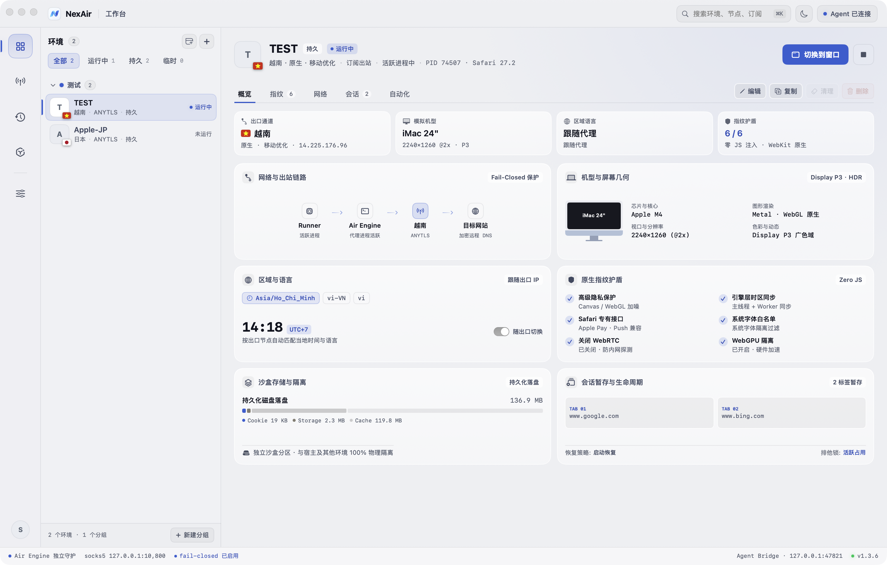
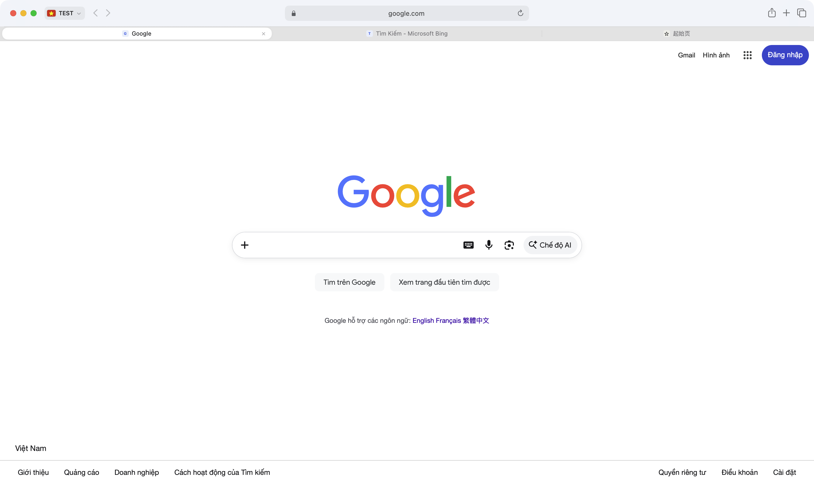
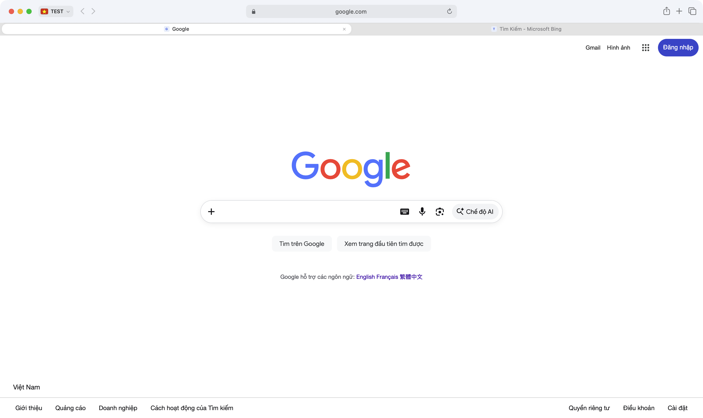

<div align="center">
  
  <h1 style="margin-top: 16px; font-size: 34px; font-weight: 800; letter-spacing: -0.02em;">NETAIR</h1>
  <p style="font-size: 16px; font-weight: 500; color: #6e6e73;">
    <strong>专为 macOS 打造的高保真多环境指纹浏览器与 AI Agent 运行基座</strong>
  </p>
  <p style="max-width: 720px; font-size: 13.5px; line-height: 1.6; color: #86868b;">
    为跨境电商、多账号运营、广告投放与 AI 自动化团队打造 · 原生 macOS 14+ Sonoma 与 15+ Sequoia 架构 · Apple WebKit 真实内核 · 零 JS 注入 · Fail-Closed 断网防护
  </p>
  <p>
    <a href="https://github.com/XideaDev/NETAir.APP/releases/latest"></a>
    
    
    
    
    
  </p>
  <p>
    <a href="README.md">English</a> · <strong>简体中文</strong> · <a href="#-为什么选择-netair">核心优势</a> · <a href="#-业务适用场景">适用场景</a> · <a href="#-核心功能与产品特性">功能特性</a> · <a href="#-ai-agent-与-mcp-生态">AI Agent</a> · <a href="#-下载与安装指引">下载安装</a>
  </p>
</div>

---

## ⚡ 为什么选择 NETAIR？

市面上绝大多数多账号指纹浏览器均基于 Chromium 或 Electron 改装。为了伪造不同的设备指纹，它们通常在页面加载前执行外部 JavaScript 脚本，强制修改 `window`、`navigator` 及硬件参数。

现代企业级风控系统（**Cloudflare Turnstile、DataDome、Akamai、Kasada** 等）通过原型链校验、函数原生性检测和跨 frame 属性比对，极易识别出被篡改的浏览器环境。

```
传统改装方案 (Chromium) ──► 注入 JS 篡改原型链 ──► 触发 Cloudflare / DataDome 风险拦截
NETAIR 原生 WebKit 方案  ──► 系统级环境与原生引擎配置 ──► 真实 Safari 环境，混入苹果生态池
```

### NETAIR 与传统方案对比

| 特性维度 | 传统 Chromium 改装方案 | NETAIR 原生方案 |
|---|---|---|
| **底层内核** | 改装 Chromium / Electron | 苹果原生 Apple WebKit (Safari 同源内核) |
| **指纹机制** | 注入 JS 脚本篡改原型链属性 | macOS 系统级环境变量与原生引擎深度协同 |
| **风控识别** | 易因原型链异常与脚本痕迹被拦截 | 呈现为纯正 Mac Safari，天然混入苹果亿级设备池 |
| **断网保护** | 软代理转发，断流时易回退直连泄露真实 IP | 严格 Fail-Closed 熔断，代理中断立即终止流量传输 |
| **凭据安全** | 明文存储或依赖云端托管数据库 | 本地加密沙盒保险箱与 macOS 钥匙串双轨保护 |
| **系统体验** | 内存与 CPU 开销大，界面响应迟缓 | 原生 AppKit 与 SwiftUI 构建，多标签流畅自如 |
| **AI 自动化** | 依赖外部插件驱动，易失效断连 | 原生支持 MCP 协议无缝接入，支持系统级 CLI 控制 |

### 三大核心承诺

1. 🛡️ **绝对零 JS 注入**：
   NETAIR 绝不在常规浏览页面中注入任何脚本，不篡改网页的原型链与全局上下文。目标网站读取到的 DOM 规范、硬件参数和渲染表现与真实 Mac Safari 完全一致。
2. 🔒 **网络严格断网阻断（Fail-Closed）**：
   每个环境绑定独立代理出口。代理连接中断或解析异常时立即停止加载并切断流量，绝对不自动回退到本机直连网络，从根源杜绝真实 IP 暴露与 DNS 泄露风险。
3. 🔐 **本地沙盒加密保险箱**：
   所有代理节点信息、登录凭据与环境配置均保存在本机加密保险箱与系统钥匙串中，不上传至任何中心化云端服务器，严格保护账号与资产安全。

---

## 🎯 业务适用场景

- **跨境电商多店铺运营**：亚马逊（Amazon）、eBay、Shopee、TikTok Shop、速卖通（AliExpress）、沃尔玛（Walmart）等多平台多店铺独立隔离，防止关联封禁。
- **海外社媒矩阵管理**：Twitter / X、Facebook、Instagram、LinkedIn、YouTube、Discord 等账号多开独立运营，会话状态长期稳定保持。
- **广告投放与效果核验**：Google Ads、Meta Ads 广告投放与着陆页多地区展示效果核验，准确获取本地化展现形态。
- **账号资产养护与防封**：完全独立的 Cookie、本地存储、历史记录与设备环境，为高价值数字资产提供纯净安全的浏览环境。
- **AI Agent 自动化与批量工作流**：支持结合 Claude Desktop、Cursor、Codex 等主流智能体工具，稳定执行网页信息提取、表单提交与无障碍操作。

---

## ✨ 核心功能与产品特性

### 1. 34 款真实 Mac 机型硬件库
精确模拟 Apple Silicon 与 Intel 架构真实 Mac 设备，视口几何比例、Retina 缩放比、Display P3 广色域及 HDR/EDR 表现与真实机器一致：
- **MacBook Pro 16" & 14"**（Apple Silicon M 系列芯片、Liquid Retina XDR 极亮屏、Display P3、刘海屏几何特征）
- **MacBook Air 15" & 13"**（超薄便携、Display P3 屏幕）
- **iMac 24" 4.5K Retina**（4480×2520 @2x 桌面超高清屏幕）
- **Mac Studio（搭配 5K Studio Display）**（5120×2880 @2x）
- **Mac Pro（搭配 6K Pro Display XDR）**（6016×3384 @2x，P3 HDR）

### 2. 语言与时区自动跟随出口 IP
选择海外代理节点后，NETAIR 自动探测出站 IP 地理位置，毫秒级同步匹配：
- **浏览器语言栈**（`Accept-Language` 与语言首选项）
- **系统底层时区**（与节点物理所在时区完全一致）
- **区域格式化**（货币、数字与日历格式）

### 3. 系统字体指纹隔离
系统级屏蔽电脑上自行安装的第三方字体，保留纯净的 macOS 基础字体库（涵盖完整中日韩基础字库），有效阻断网站通过 Canvas 与 CSS 字体枚举探测识别设备。

### 4. 内置全协议代理网络引擎
无需开启任何外部代理客户端，支持直接导入通用订阅链接或批量粘贴节点链接：
- `VLESS`（Reality / uTLS / Vision / gRPC / WebSocket）
- `VMess`（WebSocket / gRPC / TLS）
- `Trojan`
- `Shadowsocks` & `SS2022`
- `AnyTLS`、`SOCKS5`、`HTTP`

### 5. 环境级物理沙盒与会话恢复
每个沙盒环境拥有完全隔离的 Cookie、LocalStorage、IndexedDB 和浏览历史，支持沙盒重启后自动恢复上次打开的所有标签页。

### 6. 1:1 Safari 高保真体验与高性能标签架构
- **Safari 胶囊标签栏**：高 30pt、10.5pt 连续超椭圆圆角，轨道自适应平铺与优雅间距。
- **纯矢量国旗胶囊**：精细自绘真实国旗图标，支持一键展开实时出站详情。
- **高并发流畅架构**：采用生命周期事件驱动更新，同时开启 15–20 个标签页依然流畅稳定，无界面卡顿。

### 7. 全链路安全与隐私防护
- **凭据本机强加密**：敏感节点信息与账号凭据严格保存在本地加密保险箱中。
- **安全隔离属性标记**：下载文件附带标准 macOS 安全隔离元数据，保护系统安全。
- **数字防伪签名**：所有发布版本均经过 Ed25519 非对称加密数字签名校验。

---

## 🤖 AI Agent 与 MCP 生态

NETAIR 专为自主 AI Agent（Claude Desktop、Cursor、Codex、OpenCode 等）设计，提供系统级浏览器自动化基座。

### 全生态 MCP 服务器自动注册
应用启动时会自动将 Model Context Protocol (MCP) 配置注册至系统环境，无需繁琐的人工配置：
- **标准全局 Agent 规范**：写入 `~/.agents/servers/netair.json`
- **项目级 Agent 规范**：写入 `{Workspace}/.agents/servers/netair.json`
- **Codex 自动集成**：自动配置于 `~/.codex/config.toml`
- **OpenCode 自动集成**：自动配置于 `~/.config/opencode/opencode.json`
- **Claude Desktop 与 Cursor**：自动配置于 `claude_desktop_config.json` 与 `~/.cursor/mcp.json`
- **CLI 全局工具**：自动链接至 `~/.local/bin/netair`

### Agent CLI 自动化指令示例

可通过命令行工具驱动指定环境完成自动化任务：

```bash
NX="/Applications/NETAir.app/Contents/MacOS/NETAir"

# 1. 查询当前已配置的沙盒环境
"$NX" agent spaces

# 2. 在指定沙盒中打开网页
"$NX" agent open "Workspace US" https://example.com --background

# 3. 获取无障碍语义快照
"$NX" agent snapshot "Workspace US"

# 4. 驱动表单输入与元素交互
"$NX" agent fill "Workspace US" e1 "user@example.com"
"$NX" agent click "Workspace US" e2
```

---

## 📸 界面展示

<div align="center">
  
  <p><em>NETAIR 现代化管理控制台 · 便捷的多环境仪表盘与 Bento 布局</em></p>
</div>

<br />

<div align="center">
  <table width="100%" style="border: none;">
    <tr>
      <td width="50%" align="center" style="border: none;">
        
        <br /><strong>1:1 Safari Chrome 胶囊标签栏</strong>
      </td>
      <td width="50%" align="center" style="border: none;">
        
        <br /><strong>单标签自动紧凑收拢模式与矢量国旗胶囊</strong>
      </td>
    </tr>
  </table>
</div>

---

## 📥 下载与安装指引

直接下载打包好的 Universal 独立应用程序（同时支持 **Apple 芯片 M 系列** 与 **Intel 芯片 Mac**，要求 **macOS 14 Sonoma** 或 **macOS 15 Sequoia** 或更高版本）：

| 安装包名称 | 适配架构 | 构建说明 | 下载地址 |
|---|---|---|---|
| **`NETAir-1.3.8-Universal.zip`** | **Universal** (`arm64` + `x86_64`) | 最新正式版本 (Build 91) | [**立即下载最新版 (GitHub Releases)**](https://github.com/XideaDev/NETAir.APP/releases/latest) |

### 安装与首次启动指引

1. 下载并解压 **`NETAir-1.3.8-Universal.zip`**；
2. 将 **`NETAir.app`** 拖移至你的 **`/Applications`**（应用程序）目录；
3. 若首次打开时系统 Gatekeeper 弹出未验证提示，在终端执行一次解禁即可：
   ```bash
   xattr -dr com.apple.quarantine "/Applications/NETAir.app"
   ```
4. 从“应用程序”文件夹启动 **NETAIR** 即可开始使用。

---

## 🔄 自动化静默更新

NETAIR 内置静默更新检测机制。所有安装包均经过 Ed25519 数字防伪签名校验，杜绝篡改与劫持。发现新版本时在界面以发光状态灯轻量提示，点击即可完成平滑更新。

---

## ⌨️ 常用原生快捷键速查

| 快捷键 | 功能操作 |
|---|---|
| `⌘T` / `⌘N` | 新建标签页 / 新建窗口 |
| `⌘W` / `⌥⌘W` | 关闭当前标签页 / 关闭其他标签页 |
| `⇧⌘T` | 恢复最近关闭的标签页 |
| `⌘1` – `⌘8` / `⌘9` | 切换至第 1–8 个标签 / 切换至末尾标签 |
| `⇧⌘]` / `⇧⌘[` | 向右切换标签 / 向左切换标签 |
| `⌘L` | 聚焦智能胶囊地址栏 |
| `⌘R` / `⌥⌘R` | 刷新页面 / 强制无缓存硬刷新 |
| `⌘+` / `⌘-` / `⌘0` | 网页放大 / 网页缩小 / 恢复实际大小 |
| `⌥⌘I` / `⌥⌘U` | 审查元素 (Web Inspector) / 查看网页源代码 |
| `⌘\`` / `⌘·` | 快速循环切换窗口（兼容中英文输入法） |

---

## 📄 商业许可与官方支持

- **NETAIR** 为专有商业软件，保留所有权利。
- **官方网站**：[https://www.netair.app](https://www.netair.app)
- **问题反馈与建议**：欢迎在 [GitHub Issues](https://github.com/XideaDev/NETAir.APP/issues) 提交反馈与建议。
- **第三方组件说明**：底层辅助网络组件遵循其各自的开源许可证分发，完整声明已随应用程序包附带。

© NETAIR. All rights reserved.
